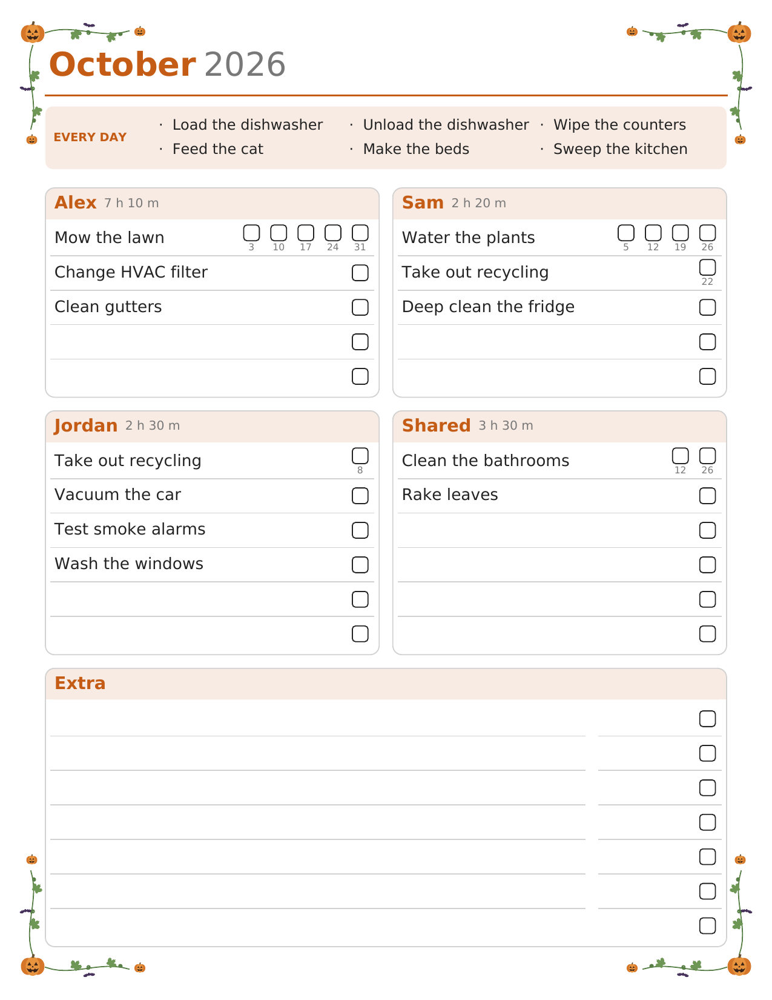

# Chore Chart

A Home Assistant app for household chores. Keep the chore list in Home Assistant, and print a one-page sheet each month to cross chores off by hand.

[](https://my.home-assistant.io/redirect/supervisor_add_addon_repository/?repository_url=https%3A%2F%2Fgithub.com%2Fbrgoldbach%2Fchore-chart)



## Features

- Chores that repeat every N weeks, months, or years, aligned to any month. Week chores can fall on a set weekday.
- Owners who take turns, or share a chore with the time split evenly.
- Optional time estimates, seasons (for example April to October), and notes.
- A printable sheet in two styles: Cards (a card per person) or Week grid (a column per week).
- Built-in layouts, and your own saved ones: text size, a color you pick for each person, box style, landscape, a custom title, and more.
- Fit to one page: a full month gives up write-in lines, then smaller text, before it runs onto page 2.
- Corner decorations for each season and for Easter, the 4th of July, Halloween, Thanksgiving, and Christmas.
- On-screen check-off, a year view of each person's hours, and a chore calendar.
- Printer search (AirPrint, IPP Everywhere, Mopria) and auto-print on the 1st of each month.
- Export and import of all chores as a JSON file.

The app is built around the printed sheet. Notifications, owners linked to Home Assistant users, and entities for dashboards are possible future work.

## Install

1. Select the button above, or go to **Settings → Apps → Install app → ⋮ → Repositories** and add `https://github.com/brgoldbach/chore-chart`.
2. Find **Chore Chart** in the app store, then select **Install**.
3. Start it, and turn on **Show in sidebar**.

The app's **Documentation** tab covers setup: owners, the printer, and auto-print. The same text is in [chore_chart/DOCS.md](chore_chart/DOCS.md).

## Development

Run the app locally in Docker. Without the Home Assistant Supervisor, it listens on port 8099 and accepts any client.

```bash
docker build -t chore-chart chore_chart
docker run --rm -p 8099:8099 -v chore-data:/data chore-chart
```

Run the unit tests inside the image, where the PDF library and fonts are:

```bash
docker run --rm -v $PWD/chore_chart/tests:/tests --entrypoint python3 chore-chart -m unittest discover -s /tests
```

To publish an update, raise `version` in [chore_chart/config.yaml](chore_chart/config.yaml) and add an entry to [chore_chart/CHANGELOG.md](chore_chart/CHANGELOG.md). Home Assistant then offers the update.

## License

[MIT](LICENSE)
